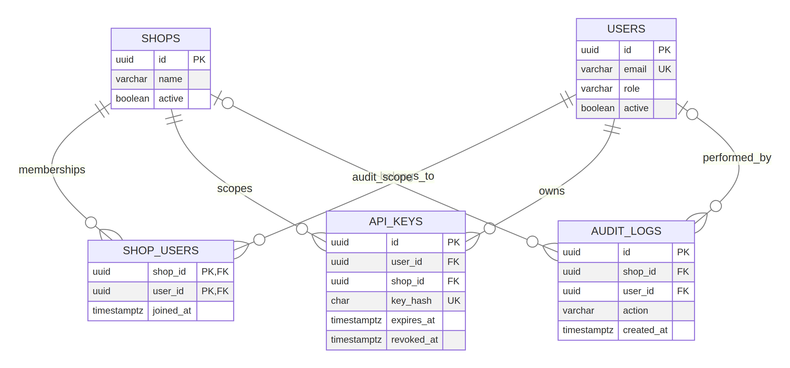
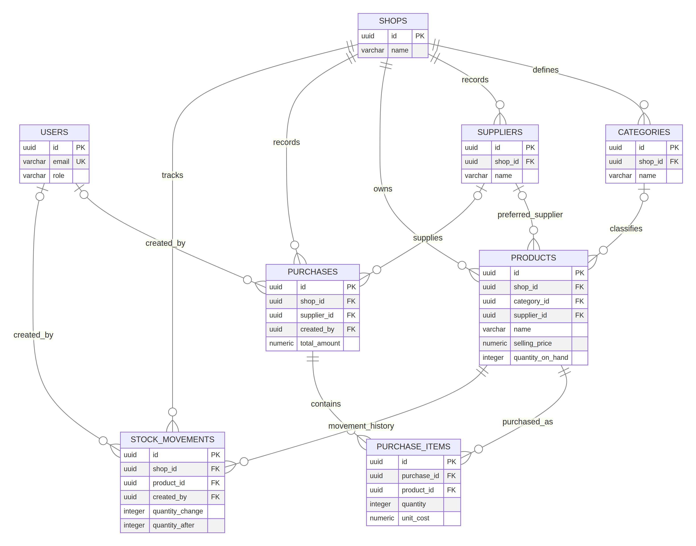
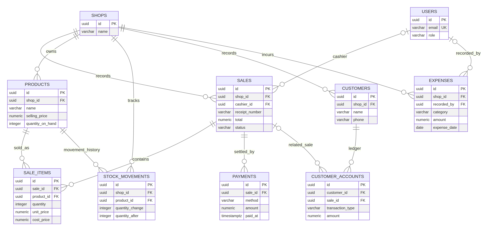

# Spaza FEVER Intelligence — Capstone Database Design

**Project:** Spaza FEVER Intelligence Retail Management System  
**Deliverable:** Capstone database design and SQL implementation blueprint  
**Platform:** React + Express + PostgreSQL 15  
**Prepared:** 27 October 2026  
**Scope:** Current application and its PostgreSQL schema, including the personal API-key extension

> **Implementation status:** This is a runnable, database-backed website, not a static mockup. The document describes the current code and SQL. It also marks limitations and recommended next-iteration changes instead of presenting unimplemented features as complete.

## 1. Project title and problem statement

Independent spaza shops and small retailers need a dependable way to keep product, stock, purchasing, sales, payment, expense, customer, and staff records in one place. When these records are held in notebooks or separate files, owners and managers can have difficulty answering basic questions: what sold today, what needs reordering, what stock is worth, what was purchased from a supplier, and whether expenses are reducing operating performance.

Spaza FEVER Intelligence provides a web-based retail operations system backed by PostgreSQL. It organizes the shop's business records, records stock changes, supports customer orders and management operations, and applies account roles and shop membership to protect access. The database is the persistent source of truth; the website is the application that reads and changes those records through an Express API.

## 2. Target users and stakeholders

| User or stakeholder | Purpose and data access |
|---|---|
| Shop owner / Admin | Oversees the shop, provisions team access, reviews shop-level health and audit history, and can perform management operations. |
| Manager | Maintains the catalogue and stock operations, records purchasing and expenses, and reviews sales and reports. |
| Cashier / Customer account | The application's public registration creates the least-privileged Customer account. A signed-in customer can browse products and submit an order. The current database stores this app role as `CASHIER`. |
| External customer record | A shop may keep customer contact records and customer-account transactions. These records are distinct from website login accounts in the current schema. |
| Supplier | External business party supplying stock. Supplier contact information is stored; the supplier does not sign in to this website. |

## 3. Business processes represented

1. **Account access:** A public registrant creates a Customer account. A trusted operator bootstraps the first Admin locally; Admins then create shop team accounts and assign roles. Users can manage personal API keys and change their own passwords.
2. **Shop catalogue:** A Manager or Admin organizes products by shop category and optional supplier, with SKU/barcode, selling and cost prices, stock on hand, and minimum stock threshold.
3. **Procurement and receiving:** A Manager or Admin records a purchase and its line items. Receiving increases product stock and creates stock-movement history.
4. **Order and sale:** A signed-in customer browses available products and submits an order. The API checks stock and records a sale, line items, cash payment, quantity reduction, and stock movements in a database transaction.
5. **Stock monitoring:** The dashboard calculates product counts, stock value, and low-stock alerts. Managers can query movement history and record purchases.
6. **Operating expenses and customer accounts:** The schema stores dated expense entries and customer-account charges, payments, or adjustments. Customer-account balance workflows are represented in the data model; a full customer-account UI workflow is not currently exposed.
7. **Reporting and audit:** Managers/Admins can retrieve daily sales, best sellers, expenses, and operational history. Admin events are written to audit logs.

## 4. Functional requirements

| ID | Requirement | Current status |
|---|---|---|
| FR-01 | Persist shop, user, and membership records in PostgreSQL. | Implemented |
| FR-02 | Authenticate users with email/password and store passwords as scrypt hashes. | Implemented |
| FR-03 | Restrict public registration to Customer access; role input from a public caller must not grant privilege. | Implemented in current code |
| FR-04 | Allow a trusted local bootstrap process to create the first Admin. | Implemented via `pnpm bootstrap:admin` |
| FR-05 | Allow Admins to create same-shop team accounts and change roles or active status. | Implemented in API and Admin UI |
| FR-06 | Allow each account to create and revoke its own hashed API keys. | Implemented |
| FR-07 | Allow customers to browse active products and submit orders with stock validation. | Implemented |
| FR-08 | Allow Managers/Admins to create/update/deactivate products and manage categories and suppliers through API endpoints. | API implemented; several management screens/actions remain future UI work |
| FR-09 | Record purchases, sale lines, payments, stock movements, expenses, and customer records. | Database/API implemented; some workflows have API access without a complete dedicated UI |
| FR-10 | Provide shop-scoped dashboards, sales/stock reports, and a database-aware assistant. | Implemented |
| FR-11 | Keep an audit trail for selected account and product administration actions. | Partially implemented; not every write route currently emits an audit event |
| FR-12 | Preserve data integrity through primary/foreign keys, unique constraints, check constraints, and transactions. | Core constraints and transactional sale/purchase writes implemented; cross-shop consistency can be strengthened |

## 5. Entity overview

The current relational model has 17 tables. `shops` is the tenant boundary. `users` holds global login identities; `shop_users` connects identities to shops. Retail records carry a `shop_id` directly or inherit shop context through their parent transaction.

| Entity | Purpose |
|---|---|
| `shops` | Retail shop / tenant record. |
| `users` | Login identity, password hash, global role and active state. |
| `shop_users` | Many-to-many shop membership and membership date. |
| `api_keys` | Per-user, per-shop hashed bearer credentials, expiry and revocation state. |
| `categories` | Shop-specific product categories. |
| `suppliers` | Shop-specific supplier contact records. |
| `products` | Catalogue item, price, stock and reorder threshold. |
| `purchases` | Stock-receipt / supplier purchase header. |
| `purchase_items` | Product and quantity detail for a purchase. |
| `sales` | Completed/voided/refunded retail transaction header. |
| `sale_items` | Product, quantity and historical prices for a sale. |
| `payments` | One or more tender records associated with a sale. |
| `stock_movements` | Signed stock change and resulting quantity history. |
| `expenses` | Dated shop operating expense. |
| `customers` | Shop customer contact record. |
| `customer_accounts` | Customer charge/payment/adjustment ledger entries. |
| `audit_logs` | Administrative and operational event record. |

## 6. Attributes, primary keys and foreign keys

Notation: **PK** = primary key; **FK** = foreign key; **NN** = not null; **UQ** = unique; **CHK** = check constraint. UUID identifiers are generated with PostgreSQL `gen_random_uuid()` unless noted. Monetary values use `NUMERIC(12,2)`; timestamps use `TIMESTAMPTZ`.

### 6.1 Shop and access tables

**`shops`** — **PK** `id UUID`; `name VARCHAR(150) NN`; `owner_name VARCHAR(150)`; `phone VARCHAR(40)`; `email VARCHAR(150)`; `address TEXT`; `active BOOLEAN NN DEFAULT true`; `created_at TIMESTAMPTZ NN DEFAULT now()`; `updated_at TIMESTAMPTZ NN DEFAULT now()`.

**`users`** — **PK** `id UUID`; `full_name VARCHAR(150) NN`; `email VARCHAR(150) NN UQ`; `password_hash TEXT NN`; `role VARCHAR(20) NN CHK IN (OWNER, MANAGER, CASHIER, ADMIN)`; `active BOOLEAN NN DEFAULT true`; `created_at TIMESTAMPTZ NN DEFAULT now()`; `updated_at TIMESTAMPTZ NN DEFAULT now()`. Passwords are never stored in plaintext. The global unique email means one login identity can join multiple shops.

**`shop_users`** — **composite PK** (`shop_id`, `user_id`); **FK** `shop_id → shops.id ON DELETE CASCADE`; **FK** `user_id → users.id ON DELETE CASCADE`; `joined_at TIMESTAMPTZ NN DEFAULT now()`. This resolves the many-to-many relationship between shops and login identities.

**`api_keys`** — **PK** `id UUID`; **FK** `user_id → users.id ON DELETE CASCADE`; **FK** `shop_id → shops.id ON DELETE CASCADE`; `name VARCHAR(80) NN`; `key_prefix VARCHAR(20) NN`; `key_hash CHAR(64) NN UQ`; `created_at TIMESTAMPTZ NN DEFAULT now()`; `last_used_at TIMESTAMPTZ`; `expires_at TIMESTAMPTZ`; `revoked_at TIMESTAMPTZ`; **CHK** expiry is later than creation. The bearer secret is displayed once; only its SHA-256 digest is persisted.

### 6.2 Catalogue and supply tables

**`categories`** — **PK** `id UUID`; **FK** `shop_id → shops.id ON DELETE CASCADE`; `name VARCHAR(100) NN`; `active BOOLEAN NN DEFAULT true`; **UQ** (`shop_id`, `name`).

**`suppliers`** — **PK** `id UUID`; **FK** `shop_id → shops.id ON DELETE CASCADE`; `name VARCHAR(150) NN`; `phone VARCHAR(40)`; `email VARCHAR(150)`; `address TEXT`; `active BOOLEAN NN DEFAULT true`; `created_at TIMESTAMPTZ NN DEFAULT now()`.

**`products`** — **PK** `id UUID`; **FK** `shop_id → shops.id ON DELETE CASCADE`; nullable **FK** `category_id → categories.id ON DELETE SET NULL`; nullable **FK** `supplier_id → suppliers.id ON DELETE SET NULL`; `name VARCHAR(150) NN`; `sku VARCHAR(80)`; `barcode VARCHAR(100)`; `unit VARCHAR(30) NN DEFAULT 'item'`; `cost_price NUMERIC(12,2) NN DEFAULT 0 CHK >= 0`; `selling_price NUMERIC(12,2) NN CHK >= 0`; `quantity_on_hand INTEGER NN DEFAULT 0 CHK >= 0`; `minimum_stock INTEGER NN DEFAULT 0 CHK >= 0`; `active BOOLEAN NN DEFAULT true`; `created_at`, `updated_at TIMESTAMPTZ NN DEFAULT now()`; **UQ** (`shop_id`, `sku`) and (`shop_id`, `barcode`).

**`purchases`** — **PK** `id UUID`; **FK** `shop_id → shops.id`; nullable **FK** `supplier_id → suppliers.id ON DELETE SET NULL`; `invoice_number VARCHAR(80)`; `total_amount NUMERIC(12,2) NN DEFAULT 0 CHK >= 0`; `purchased_at TIMESTAMPTZ NN DEFAULT now()`; nullable **FK** `created_by → users.id ON DELETE SET NULL`; `notes TEXT`.

**`purchase_items`** — **PK** `id UUID`; **FK** `purchase_id → purchases.id ON DELETE CASCADE`; **FK** `product_id → products.id`; `quantity INTEGER NN CHK > 0`; `unit_cost NUMERIC(12,2) NN CHK >= 0`; `line_total NUMERIC(12,2)` generated as `quantity * unit_cost`.

### 6.3 Sales and stock tables

**`sales`** — **PK** `id UUID`; **FK** `shop_id → shops.id`; nullable **FK** `cashier_id → users.id ON DELETE SET NULL`; `receipt_number VARCHAR(80) NN`; `subtotal NUMERIC(12,2) NN DEFAULT 0 CHK >= 0`; `discount NUMERIC(12,2) NN DEFAULT 0 CHK >= 0`; `total NUMERIC(12,2) NN CHK >= 0`; `status VARCHAR(20) NN DEFAULT 'COMPLETED' CHK IN (COMPLETED, VOIDED, REFUNDED)`; `sold_at TIMESTAMPTZ NN DEFAULT now()`; **UQ** (`shop_id`, `receipt_number`).

**`sale_items`** — **PK** `id UUID`; **FK** `sale_id → sales.id ON DELETE CASCADE`; **FK** `product_id → products.id`; `quantity INTEGER NN CHK > 0`; `unit_price NUMERIC(12,2) NN CHK >= 0`; `cost_price NUMERIC(12,2) NN CHK >= 0`; `line_total NUMERIC(12,2)` generated as `quantity * unit_price`. Historical cost and selling prices preserve transaction-time values.

**`payments`** — **PK** `id UUID`; **FK** `sale_id → sales.id ON DELETE CASCADE`; `method VARCHAR(30) NN CHK IN (CASH, CARD, EFT, MOBILE_MONEY, CREDIT)`; `amount NUMERIC(12,2) NN CHK >= 0`; `paid_at TIMESTAMPTZ NN DEFAULT now()`; `reference VARCHAR(100)`.

**`stock_movements`** — **PK** `id UUID`; **FK** `shop_id → shops.id`; **FK** `product_id → products.id`; `movement_type VARCHAR(30) NN CHK IN (PURCHASE, SALE, ADJUSTMENT, RETURN, DAMAGE)`; `quantity_change INTEGER NN CHK <> 0` (positive adds stock, negative removes); `quantity_after INTEGER NN CHK >= 0`; nullable `reference_id UUID` (currently polymorphic, not a declared FK); `notes TEXT`; nullable **FK** `created_by → users.id ON DELETE SET NULL`; `created_at TIMESTAMPTZ NN DEFAULT now()`.

### 6.4 Operating and customer tables

**`expenses`** — **PK** `id UUID`; **FK** `shop_id → shops.id`; `category VARCHAR(80) NN`; `description TEXT NN`; `amount NUMERIC(12,2) NN CHK > 0`; `expense_date DATE NN DEFAULT current_date`; nullable **FK** `recorded_by → users.id ON DELETE SET NULL`; `created_at TIMESTAMPTZ NN DEFAULT now()`.

**`customers`** — **PK** `id UUID`; **FK** `shop_id → shops.id ON DELETE CASCADE`; `name VARCHAR(150) NN`; `phone VARCHAR(40)`; `email VARCHAR(150)`; `active BOOLEAN NN DEFAULT true`; `created_at TIMESTAMPTZ NN DEFAULT now()`.

**`customer_accounts`** — **PK** `id UUID`; **FK** `customer_id → customers.id ON DELETE CASCADE`; nullable **FK** `sale_id → sales.id ON DELETE SET NULL`; `transaction_type VARCHAR(20) NN CHK IN (CHARGE, PAYMENT, ADJUSTMENT)`; `amount NUMERIC(12,2) NN CHK > 0`; `notes TEXT`; `created_at TIMESTAMPTZ NN DEFAULT now()`.

**`audit_logs`** — **PK** `id UUID`; nullable **FK** `shop_id → shops.id ON DELETE SET NULL`; nullable **FK** `user_id → users.id ON DELETE SET NULL`; `action VARCHAR(80) NN`; `entity_type VARCHAR(80)`; nullable `entity_id UUID` (polymorphic, not a declared FK); `details JSONB`; `created_at TIMESTAMPTZ NN DEFAULT now()`.

## 7. Relationship rules and cardinality

| Relationship | Cardinality | Implementation |
|---|---|---|
| Shop — membership — User | M:N | `shop_users` composite key records membership; one user can access multiple shops. |
| User — API key | 1:M | Each key belongs to one user; each user may create many keys. |
| Shop — API key | 1:M | Key is issued in a shop context; current API requires that user membership for the key's shop. |
| Shop — Category / Supplier / Product / Customer | 1:M | Each record is scoped to one shop. |
| Category — Product | 1:M, optional on product | A product has zero or one category; a category can classify many products. |
| Supplier — Product | 1:M, optional on product | A product can name one preferred supplier; a supplier can supply many products. |
| Supplier — Purchase | 1:M, optional on purchase | A purchase may be associated with one supplier. |
| Purchase — Purchase item | 1:M | A purchase consists of one or more product lines. |
| Product — Purchase item | 1:M | Product may appear on many purchase lines. |
| Shop — Sale | 1:M | Each sale belongs to one shop. |
| User — Sale | 1:M, optional cashier | The cashier reference may be null if the account is removed. |
| Sale — Sale item / Payment | 1:M | A sale has sale lines and may be settled by one or more payments. |
| Product — Sale item / Stock movement | 1:M | Product history is retained in sale lines and stock movements. |
| Customer — Customer account | 1:M | Each ledger entry belongs to a customer; a charge can optionally refer to a sale. |
| Shop — Expense / Audit log | 1:M, audit nullable | An expense belongs to a shop; audit data can survive shop deletion with null scope. |

## 8. Entity-relationship diagram

The ERD is split into three readable domain views. Together they cover all 17 current tables; shared tables such as `shops`, `users`, and `products` repeat where needed to show cross-domain relationships. `PK` and `FK` labels appear in the detailed data dictionary above.







The editable Mermaid source for the full overview and focused diagrams is included as `docs/Spaza_FEVER_ERD.mmd` and `docs/ERD_*.mmd`.

## 9. Draft table design and normalization

The production schema is already drafted as SQL in `database/init/001_schema.sql` and `database/init/003_api_keys.sql`. The relational structure separates transaction headers from transaction lines (`purchases` / `purchase_items` and `sales` / `sale_items`), uses a membership table for shop access, and records stock changes as append-only movement rows. Monetary values are fixed-point decimals rather than floating-point numbers. Generated line totals and check constraints reduce invalid data.

The design is substantially normalized for the current workflow: product category names, supplier contacts, and user profiles are stored once; sales and purchases store repeated product lines in child tables. Transaction-time prices are copied into purchase and sale lines so later price changes do not rewrite past transactions. The following design decisions should be discussed before expanding the system:

- **App customer versus retail customer:** Public web accounts are stored as `users` with database role `CASHIER`; retail contact records are stored separately in `customers`. `sales` has `cashier_id` but no `customer_id`, so the current web-order route records the logged-in customer identity in the cashier field. For clearer business semantics, a next schema version should add a nullable `customer_id` to `sales` or an explicit mapping from a login user to a customer record, and reserve `cashier_id` for staff.
- **Same-shop consistency:** The API scopes queries by the authenticated shop and validates key paths. Some plain foreign keys do not themselves guarantee both ends belong to the same shop. Consider composite unique keys/FKs such as (`shop_id`, `id`) on tenant tables and composite references for product/category/supplier/transaction lines.
- **Payment reconciliation:** The schema supports multiple payment rows but does not constrain their sum to equal the sale total. Add application-level transactional reconciliation or a deferred trigger if partial tenders are required.
- **Polymorphic references:** `stock_movements.reference_id` and `audit_logs.entity_id` can refer to different entity types and therefore are not ordinary foreign keys. Add typed reference columns/tables if strict referential integrity is required.
- **Role model:** `users.role` is global while shop access is many-to-many. If a user needs different roles in different shops, move role to `shop_users` in a future migration.

These are explicit next-iteration items, not blockers for understanding the current implemented schema. Avoid changing the existing database without a migration, backup, and test plan.

## 10. Business questions the database should answer

1. What was the shop's completed sales revenue and transaction count for each day in a selected date range?
2. Which products sold the most units and generated the most sales revenue during that range?
3. Which active products are at or below minimum stock, and how many units should be ordered to reach a chosen target?
4. What is the estimated current inventory value at cost by shop, category, or product?
5. How much stock was received from each supplier over a selected period, and what was the purchase cost?
6. What are the shop's expenses by category and date range, and how do they compare with revenue?
7. Which payment methods were used for sales, and do payment totals reconcile to each sale total?
8. What is the estimated gross margin by product using the historical unit cost stored on sale lines?
9. What is a customer's outstanding account balance from charges, payments, and adjustments?
10. Which team member performed an action, what changed, and when was the related API key last used or revoked?

Questions 7 and 9 expose useful reporting requirements that need careful implementation: payment reconciliation is not enforced by a database constraint, and customer-account balance is derived from ledger entries rather than stored as a cached total.

## 11. Business-question query sketches

These examples use the current table/column names. They are query sketches for design review, not new website routes.

**Daily revenue and count:**
```sql
SELECT shop_id, sold_at::date AS sale_date, SUM(total) AS revenue, COUNT(*) AS transactions
FROM sales WHERE status = 'COMPLETED'
GROUP BY shop_id, sold_at::date ORDER BY sale_date;
```

**Low stock:**
```sql
SELECT shop_id, id, name, quantity_on_hand, minimum_stock,
       GREATEST(minimum_stock - quantity_on_hand, 0) AS suggested_replenishment
FROM products WHERE active AND quantity_on_hand <= minimum_stock;
```

**Top products and gross margin:**
```sql
SELECT p.id, p.name, SUM(si.quantity) AS units,
       SUM(si.line_total) AS sales_revenue,
       SUM(si.quantity * (si.unit_price - si.cost_price)) AS gross_margin
FROM sale_items si JOIN sales s ON s.id = si.sale_id
JOIN products p ON p.id = si.product_id
WHERE s.status = 'COMPLETED'
GROUP BY p.id, p.name ORDER BY units DESC;
```

**Customer account balance:**
```sql
SELECT customer_id,
       SUM(CASE WHEN transaction_type = 'CHARGE' THEN amount
                WHEN transaction_type = 'PAYMENT' THEN -amount
                ELSE amount END) AS balance
FROM customer_accounts GROUP BY customer_id;
```

## 12. Physical design, constraints and indexes

The implementation uses PostgreSQL 15 and `pgcrypto` for UUID generation. DDL currently includes primary keys, foreign keys, unique constraints, `CHECK` constraints for non-negative prices/stock and valid enumerated states, and generated `line_total` values. Update triggers keep `updated_at` current on shops, users, and products.

Indexes in the base schema support product/shop lookups, low-stock selection, dated sales and purchases, product movement history, expenses by shop/date, and audit history. The API-key migration adds owner/shop ordering and a partial active-key lookup index. Review query plans as real data volume grows; add indexes for measured workload rather than indexing every column.

## 13. Verification against current application functionality

| Screenshot deliverable | Project evidence / status |
|---|---|
| Define problem and users | Sections 1–2 of this document; aligns with Customer, Manager, Admin roles and supplier/customer stakeholders. |
| Identify business processes | Section 3; maps to current auth, catalogue, order, purchase, stock, expense, report and audit flows. |
| Identify entities and attributes | Sections 5–6; covers all 17 tables and their current SQL attributes. |
| Assign primary and foreign keys | Section 6 marks every PK/FK and identifies polymorphic UUID references that are not enforced FKs. |
| Define relationships | Section 7 supplies cardinality and implementation notes. |
| Create initial ERD | Section 8 embeds an ERD; editable source included. |
| Draft database tables | Section 9 assesses existing SQL tables and key normalization decisions. |
| Verify business questions | Sections 10–11 provide 10 testable questions and example query sketches. |
| Completed capstone database design ready for SQL implementation | The core schema is already implemented in SQL; recommendations for next migration are explicitly separated from current behavior. |

## 14. SQL implementation and local verification

The source-of-truth DDL is in `database/init/001_schema.sql`, seed data in `database/init/002_seed.sql`, and personal API-key extension in `database/init/003_api_keys.sql`. On a fresh Docker volume, PostgreSQL runs initialization SQL automatically. For an existing volume, execute a new migration explicitly; do not delete the volume to force initialization.

From the project root, create `.env` from `.env.example`, set a random `SESSION_SECRET`, then build and start PostgreSQL, the Express API, and the Vite frontend together:

```bash
docker compose up -d --build
docker compose ps
docker compose logs -f db api frontend
```

Open `http://localhost:5173`; API health is at `http://localhost:3001/api/health`. Run `docker compose exec api pnpm check` and `docker compose exec api pnpm build` for code checks. For database inspection, use the `psql` commands in `database/README-uploaded.md`. Run `./scripts/test-api.sh` from Ubuntu/WSL against the published API port. Create the first Admin with `docker compose exec api pnpm bootstrap:admin`, then run `./scripts/test-admin-provisioning.sh`.

This ZIP contains the application source, actual PostgreSQL DDL and seeds, Docker configuration, and runnable frontend/API; the design report supplements that functioning project and is not a replacement for it.

## References within the project

- `database/init/001_schema.sql` — base PostgreSQL DDL and constraints.
- `database/init/002_seed.sql` — local demonstration shop and sample products.
- `database/init/003_api_keys.sql` — API-key table migration.
- `server/index.ts` — Express routes, authorization, transactions, reporting, and shop scoping.
- `client/src/main.tsx` — running React user interface and role-based navigation.
- `Dockerfile` and `docker-compose.yml` — local container image and three-service development stack.
- `README.md` and `API.md` — local setup, security and endpoint documentation.
